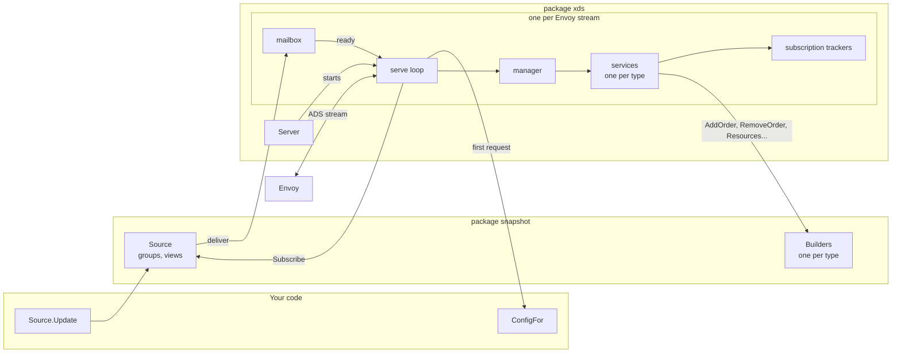
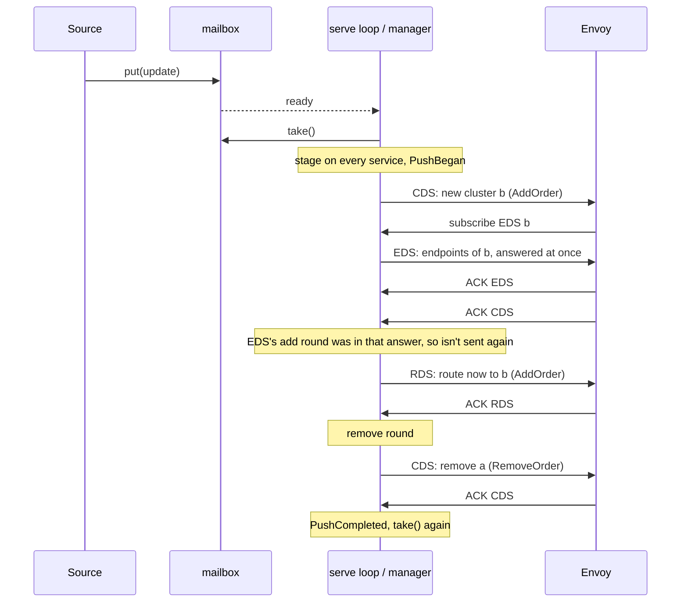

# Architecture

This is for someone about to change go-envoy-xds. [USAGE.md](USAGE.md) is for building a control plane with it.

go-envoy-xds is a Go port of [java-envoy-xds](https://github.com/JonathanO/java-envoy-xds), and should behave the
same. [AGENTS.md](../AGENTS.md) says how to keep the two in step.

## 1. Overview

A control plane tells Envoys what config to run: listeners, routes, clusters, endpoints and so on, each a protobuf
*resource* with a name and a *type*. Envoy asks for it over xDS. This library serves ADS, the aggregated discovery
service, where one gRPC stream carries every type, with either protocol:

- **SotW** (state of the world): each response is every resource of a type that Envoy has subscribed to.
- **Delta**: each response is only what changed: resources added or changed, and names removed.

Envoy answers each response with an *ACK* (accepted) or a *NACK* (rejected, with error detail).

The library's one job beyond the protocol is order. Every change is sent *make before break*: whatever a change adds
is in place before anything refers to it, and nothing is removed while anything still refers to it. A route to a new
cluster is sent only once Envoy has ACKed the cluster, and a cluster is removed only once Envoy has ACKed the routes
that stopped using it.

You give the library two things. A **Source** tells each Envoy's stream about changes, as *state updates* of a type
you choose. A **ConfigBuilder** per resource type turns an update into resources. Package `snapshot` provides both.

## 2. Components

| Component | File | Owns |
|---|---|---|
| `Server` | [server.go](../server.go) | The config: Source, builders by type, ConfigFor, Events, Metrics, logger. One per process, shared by every stream. |
| serve loop | `serve` in [server.go](../server.go) | One stream: its `Client`, its manager, and the goroutine that reads requests. |
| manager | [manager.go](../manager.go) | One stream's order: the push under way, its round and position, ACKs outstanding, held requests, freezing. |
| services | [service.go](../service.go), [sotw.go](../sotw.go), [delta.go](../delta.go) | One type on one stream: its subscriptions, the state it's serving, the staged change, versions and nonces, what's awaiting an ACK. |
| subscription trackers | [subs.go](../subs.go) | Which names a stream is subscribed to for one type, and what each request newly subscribed to. |
| mailbox | [mailbox.go](../mailbox.go) | Updates a Source has delivered to one stream that it hasn't started pushing, merged where they can be. |
| builders | your `ConfigBuilder`s, or [snapshot/builder.go](../snapshot/builder.go) | Turning an update into resources. Snapshot's keep no state: everything comes in the update. |
| snapshot | [snapshot/](../snapshot) | Groups, views, each view's published state, and who is subscribed to which view. |

**The Server** checks its config in `NewServer`: a Source and ConfigFor are required, and each builder's type must be
one of the ADS types in [types.go](../types.go) and appear once. `StreamAggregatedResources` and
`DeltaAggregatedResources` each build a service per ADS type, served or not, and hand them to `serve`. A type with no
builder still gets a service: it answers requests with nothing.

**The serve loop** is the goroutine gRPC runs the stream's handler on. It owns everything about the stream, so none of
it is locked. A second goroutine reads requests and passes them in over a channel. The loop waits on three things:
the stream ending, a request, and the mailbox's `ready` channel.

**The manager** decides when each service sends what. It holds the services in add order and in remove order. Add
order is secrets, runtime, clusters, endpoints, listeners, routes, scoped routes, virtual hosts. Remove order is
listeners, scoped routes, routes, virtual hosts, clusters, endpoints, runtime, secrets. In both, what a resource refers
to arrives before it and leaves after it.

**The services** come in two kinds, `sotwService` and `deltaService`, sharing `base`. `base` holds the state the type
is serving, the change staged for it, and which round of that change it's in. It calls the builder, and logs a warning
when a builder returns or removes a name the Envoy didn't subscribe to. A service calls its builder's `AddOrder` or
`RemoveOrder` only if Envoy has asked for the type. The SotW service also keeps `have`, what Envoy has (or will have
once it ACKs), as each SotW response must be the whole set.

**The subscription trackers** follow the
[xDS rules](https://www.envoyproxy.io/docs/envoy/latest/api-docs/xds_protocol#how-the-client-specifies-what-resources-to-return)
for which names a stream wants. Listeners, clusters, scoped routes and virtual hosts are *wildcard* types: Envoy may
subscribe to every resource at once, with `*` or, on its first request, by naming nothing (the *legacy wildcard*).
`sotwNames` and `deltaNames` track names; `sotwWildcard` and `deltaWildcard` add the wildcard. Each `update` returns
`added`, which names the request newly subscribed to (nil if none), and `changed`. A delta request that both subscribes
to and unsubscribes from one name is an error, which ends the stream with `InvalidArgument`.

**The mailbox** is the only state of a stream that another goroutine changes, apart from the request channel and
cancelling the stream's context. `put` is what the Source calls to deliver; `take` is what the manager calls to start
a push.

**The builders** turn an update into resources, for one type. See [the ConfigBuilder
docs](https://pkg.go.dev/github.com/JonathanO/go-envoy-xds#ConfigBuilder) for the five methods.

**The snapshot package** is a Source and builders: see [section 9](#9-the-snapshot-package).

## 3. A stream's life

1. Envoy opens an ADS stream. gRPC calls `StreamAggregatedResources` or `DeltaAggregatedResources`, which calls
   `serve`. Nothing else happens until the first request.
2. On the first request, `serve` calls `ConfigFor` with the stream's context and the request's node. An error ends the
   stream with that error. Otherwise it makes the `Client`, and calls `Events.Connected`.
3. A request for a type that isn't an ADS type is logged and left unanswered, as if nobody served it. Ending the
   stream would take every other type down with it.
4. A request with error detail is a NACK: `serve` logs it and calls `Events.Nacked`, then carries on to the manager.
5. On the first request of a known type, `serve` makes the mailbox and the manager, with a `Metrics` from
   `ServerConfig.Metrics`. It calls `Source.Subscribe` with the `EnvoyConfig`'s details and the mailbox's `put`.
   The update Subscribe returns becomes every service's state, so answers to subscriptions come from it.
6. Every request then goes to `manager.process`; see [Requests](#5-requests).
7. When the mailbox has updates, `serve` calls `manager.updatesWaiting`, which starts a push if one may start; see
   [A change](#4-a-change).
8. The stream ends when Envoy closes it, a send or receive fails, `Client.Resync` cancels it, a resource can't be
   marshalled, or the manager returns an error. `serve` unsubscribes from the Source, calls `Metrics.Closed`, and calls `Events.Disconnected` if
   `Connected` was called. It returns nil for a resync or Envoy closing the stream, and the error otherwise, logging
   it unless Envoy went away.

A panic anywhere in the stream's goroutine (a builder, ConfigFor, an event, the Source's Subscribe) is recovered: it's
logged at Error with the node, cleanup runs as above, and the stream ends with `codes.Internal`. Other streams are
unaffected.

## 4. A change

### The mailbox and merging

A Source delivers each update by calling the mailbox's `put`, which never blocks. If the newest update waiting is a
`Merger`, the new one merges into it; otherwise it queues. An update that is a Merger with a `MergesWithLater` method
returning false takes no later merges: that is how phases stay apart. `put` then signals `ready`, a channel with room
for one, so the serve loop wakes once however many updates arrive.

Merging matters because mesh updates come in bursts. An Envoy busy with one change gets everything that arrived
meanwhile as one change, not a queue of them, each needing its own ACKs.

### The push rounds

`pushAllowedWork` starts a push when nothing blocks it: the stream isn't frozen, no answer is awaiting an ACK, and no
request is held (see [Route requests wait for clusters](#route-requests-wait-for-clusters)): a held request may be the
first of its type, and a push skips a type Envoy hasn't asked for, though a reconnecting Envoy has some of it. Then it
sends the stale removals that may go (see [Reconnects](#7-reconnects)): if it sent any, the push waits for their ACK,
but removals that may not go yet don't hold it up. Last, `DelayUpdatesUntilAckOf` mustn't be holding updates. It takes
the next update from the mailbox, calls `Metrics.PushBegan`, and *stages* it on every service: the update becomes the
service's state, and its round becomes `adding`.

`continuePush` then walks the services:

1. **The add round**, in add order. Each service calls its builder's `AddOrder` and sends what it returns, if
   anything. If it sent something, the push waits for Envoy's ACK of it before the next service.
2. **The remove round**, in remove order, the same way with `RemoveOrder`.
3. When both rounds are done, `Metrics.PushCompleted`, and `pushAllowedWork` looks for the next update.

A service with nothing to send costs no round trip. Each ACK comes in as a request, and `handle` calls `continuePush`
again, which carries on from where it was.

### Phases

Make before break orders types, not resources within a change. Some orders it can't see: a route that stops using a
subset of a cluster has to be ACKed before the cluster drops the subset, but both are changes to existing resources
in the add round, and clusters go first. Phases fix that. An update whose `MergesWithLater` returns false is pushed,
and ACKed, alone, before anything after it. In package snapshot, `Change.Then` ends a phase; see
[section 9](#phases-1).

## 5. Requests

### Subscriptions are answered from current state

When a request subscribes to names, the service answers at once, whatever the push is doing. The answer comes from
the service's state: the staged change, if there is one.

- Until the type's remove round has been sent, the names newly subscribed to are answered from `ResourcesAddOrder`:
  the change's adds, and what it's yet to remove. Envoy is sent the change mid-way, which is consistent with the rest
  of what it has, and nothing goes before what may still refer to it.
- Otherwise they're answered from `ResourcesRemoveOrder`: everything once the change is done, or as things stand if
  no change is under way.

So that the push doesn't send it again, the SotW service sends the type's add round in the same answer, if it's still
to come, and marks it sent. The remove round always goes in its turn. The delta service instead records the names it
answered with during the add round, in `answeredDuringChange`, and drops them from the add round when it comes.

Every subscription is answered, even with nothing: Envoy waits for an answer to its first request of each type, and
to hear that names it asked for don't exist. Delta says so in `removed_resources`; SotW leaves them out. Unsubscribing
needs no answer, and gets none: an empty answer would hold up pushes until Envoy ACKed it.

After each request, a service left awaiting an ACK, typically of an answer to a subscription, goes into the
manager's `outstanding` set. No push starts until that's empty.

### Route requests wait for clusters

Listeners, routes, scoped routes and virtual hosts refer to clusters (`usesClusters` in manager.go). When Envoy
reconnects, it subscribes to everything at once. If a route subscription were answered while the clusters it uses
were still to be sent, or awaiting an ACK, the route could arrive first. So while clusters or endpoints await an ACK,
or a change's endpoints are still to be sent (`clustersPending`), `mustWait` holds a request of those types in `held`,
and `process` answers held requests, in order, once that's over.

Exceptions:

- A request of a type whose service awaits an ACK is never held, so the ACK it's waiting for never waits.
- Cluster and endpoint requests are never held. Envoy holds its CDS ACK until new clusters have warmed, which takes
  the EDS answer.
- A held NACK still freezes the stream at once. Only its subscription changes wait.

### A request never overtakes a held one of its type

Each request of a type follows on from the last: a SotW request lists every name, and a delta request changes the
last set. So once a request of a type is held, every later one of that type is held behind it, even an ACK, and they
are answered in the order they came.

### SotW and delta

| | SotW | Delta |
|---|---|---|
| Response | every subscribed resource of the type, sorted by name | only what changed: resources, and names removed |
| Version | `version_info`, counting up from 1 per type | `system_version_info`, the same counter; each resource carries its response's version |
| Nonce | the version | the version |
| ACK | the latest nonce, with `version_info` equal to it | the latest nonce |
| NACK | the latest nonce, with error detail | the latest nonce, with error detail |
| Request with an older nonce | ignored, subscriptions and all | still changes subscriptions |
| Latest nonce, another version, no error detail | logged at Error, and not an ACK | n/a |
| Reconnect | Envoy doesn't say what it has | `initial_resource_versions` says what it kept |

## 6. NACKs

A NACK *freezes* the stream (`manager.freeze`): it's sent no more changes, for good. Freezing unsubscribes from the
Source, drops the rest of the push under way, and calls `Metrics.PushCompleted` if a push was under way. Envoy keeps
serving its last good config.

The reasons are in the comment on `freeze`. A rejected change won't fix itself: resending it, or any later change that
includes it, is rejected again. Envoy may have applied part of it, so we no longer know what it has, and diffing
from a guess makes things worse. Dropping the stream would have Envoy reconnect straight away, get the same config,
and loop.

A frozen stream still answers subscriptions, from its own state, which is the rejected change's. A type the change
left mid-way answers from its add round for good, as its removals never went out, so Envoy may still use what they
would remove. For SotW the answer includes what was rejected, as each answer is the whole set. Resending it changes nothing Envoy has, where rolling it
back would undo any part of it Envoy took.

To unfreeze an Envoy, end its stream: `Client.Resync` cancels the stream's context, so `serve` returns nil and Envoy
reconnects and syncs from scratch. `ResyncAfterNack` ([resync.go](../resync.go)) does it on a backoff: it schedules a
resync on a stream's first NACK, doubles the wait each time an Envoy NACKs again after one, up to a maximum, and
starts over once an Envoy goes twice the maximum without a NACK. It keys backoffs by node ID, as a resync makes a new
stream and so a new `Client`.

## 7. Reconnects

A delta Envoy reconnecting says what it kept, in `initial_resource_versions`. Anything it kept that we no longer have
must be removed, but in remove order: a cluster it kept may still be used by routes it kept, until they're replaced.

When a subscription names *stale* resources (kept, subscribed to, and not in our state), the service asks the manager
whether it may remove them yet (`mayRemove`). It may if every type before it in remove order that's served and that
this Envoy gets has been answered and ACKed. If not, the names wait in the service's `deferred` set.
`pushDeferredRemovals`, which runs whenever a push could start, sends them in remove order, one type at a time,
waiting for each ACK, and skips names that are back since or no longer subscribed to. A push waits for the ACK of
removals that have gone. Removals that may not go yet don't hold pushes up: they're safe to leave.

`EnvoyConfig.SubscribesTo` lists the types this Envoy gets. Removals don't wait for types it leaves out. With it nil,
every served type counts, so an Envoy that never asks for one (static routes, say) holds up the removals. Not for
ever: 30 seconds after the stream's first request of a known type (`waitForAck` in api.go), the manager logs a warning and stops
waiting, for the rest of the stream. There is no timer: the wait is checked when something happens on the stream, a
request or an update.

`EnvoyConfig.DelayUpdatesUntilAckOf` holds pushes until this Envoy first ACKs that type, e.g. RouteType: Envoy ACKs
routes only once its clusters have initialised, and endpoint pushes in the meantime get in its way
([envoy#16035](https://github.com/envoyproxy/envoy/issues/16035)). It's dropped, with a warning, if `SubscribesTo`
leaves the type out, and given up on after the same 30 seconds, checked the same way.

SotW has no `initial_resource_versions`, so a reconnect finds nothing stale, and the services' `deferred` is always
empty. The first CDS answer is the whole set, so a cluster Envoy kept that we no longer have is removed at once, even
while routes Envoy kept still use it. The e2e suite skips the two scenarios that show this, as SotW can't pass them.

## 8. Concurrency

Per stream there are two goroutines of ours:

- **the serve loop**, gRPC's handler goroutine. It owns the manager, services and trackers, and makes every call to
  ConfigFor, Events, Metrics, the Source's `Subscribe` and cancel, and the builders. It's also the only goroutine that
  sends on the stream.
- **the reader**, which calls `Recv` and passes each request to the loop on an unbuffered channel. On an error it
  cancels the stream's context.

What's locked:

| Lock | Guards |
|---|---|
| `mailbox.mu` | the updates waiting for one stream |
| `snapshot.Source.mu` | groups, views, view states, subscribers |
| `viewState.mu` | a view state's lazily built merged maps |
| `ResyncAfterNack.mu` | pending resyncs and backoffs |

The Source's `deliver` (the mailbox's `put`) runs on whatever goroutine the Source calls it from. For package
snapshot, that's the goroutine calling `Source.Update`, with the Source locked, so every stream gets updates in the
same order and none is missed by a stream subscribing meanwhile. `put` takes only the mailbox's lock, appends or
merges, and signals without blocking, so it's safe to call holding any lock.

Builders run on many streams' goroutines at once, so the updates they're given must be safe to read concurrently.
Snapshot's are immutable, apart from the merged maps, which are locked.

`Client.Resync` only cancels a context, so any goroutine may call it. `ResyncAfterNack` calls it from a
`time.AfterFunc` goroutine.

## 9. The snapshot package

### Groups and views

A `Snapshot` ([snapshot.go](../snapshot/snapshot.go)) is an immutable map of resources, by type then name. `Edit`
returns an `Editor`, which copies a type's map the first time it's edited, so snapshots share every type you didn't
change. `Put` of a resource equal to what's there, or `Remove` of what isn't, changes nothing. The Editor records the
names each edit touched. `Build` leaves out types with no resources left, so `Types` yields only types with some.

A `Source` ([source.go](../snapshot/source.go)) holds named *groups*, each a Snapshot, and named *views*, each an
ordered list of groups. An Envoy sees one view, picked by `viewOf` from its details when it subscribes. Where two
groups in a view have a resource of the same type and name, the first group's wins. Group and view names are any
comparable types, so they can be distinct types of your own.

For each view, the Source keeps a `viewState` ([update.go](../snapshot/update.go)): the view's groups as published,
as a slice of Snapshot pointers. It's cheap to make, and an Envoy holding one keeps nothing else alive. Looking up one
name walks the groups. What needs the whole type (an answer to a subscription, or an update that changed the view's
groups) merges the groups into a map, once per type per view state, cached under `viewState.mu`.

### Edits and touched names

`Source.Update` runs your `edit` func on a `Change`, then applies it. `Change.EditGroup` keeps the names the Editor
touched. `SetGroup` and `RemoveGroup` touch every name in the old and new group, as there's no edit to tell. For each
view, the update says which names may differ:

- If the view's list of groups changed, `full` is set, and every name in the old and new state is compared.
- Otherwise `touched` lists the touched names of each changed group in the view.

An `Update` holds the view state before and after. The builders compare `before` and `after` for each candidate name,
looked up through the groups, with `proto.Equal`. A change shadowed by an earlier group compares equal, so sends
nothing.

`Update.Merge` keeps the oldest `previous` and the newest `current`, and joins the touched names, or sets `full` if
either was. It panics unless the second update follows on from the first.

### Waking only the Envoys a change affects

The Source indexes views by group (`viewsByGroup`) and subscribers by view. A change wakes only the views that list a
changed group, or whose groups changed, and delivers each view's update to that view's subscribers. Envoys sharing a
view share its updates and view states. A change that touched no name, like putting what's there already, wakes
nobody. Each Envoy then compares only the touched names.

`Subscribe` returns the view's current state, as an update from empty with `full` set, so a new Envoy's answers come
from the whole view.

### Phases

`Change.Then` starts a new phase: edits after it go to it. `Source.Update` applies each phase in turn, working out
each view's update for each. A view that also changes in a later phase gets this phase's update marked `endsPhase`,
whose `MergesWithLater` returns false, so the mailbox merges nothing into it and the Envoy ACKs it before the next.
Views that change in only one phase get their update as usual. An Envoy that subscribes after `Update` returns gets
the end result, as Subscribe takes the same lock. `Then` always adds a phase; an empty one changes no view, so costs
nothing.

`Update` returns each changed view's update, with its phases merged.

## 10. Metrics, Events and logging

`ServerConfig.Metrics` makes a `Metrics` per stream, when the stream's first known-type request arrives. The serve
loop calls it:

- `PushBegan` when it takes an update to push, and `PushCompleted` when the push's last ACK arrives or a NACK stops it.
- `AwaitingAck` and `Acked` as a service joins and leaves the `outstanding` set: answers to subscriptions, and
  stale removals. A push's own responses don't call them, unless a request of their type comes while they await
  their ACK.
- `Closed` when the stream ends.

So a stream is idle when no push is under way and every `AwaitingAck` has had its `Acked`. The e2e control plane uses
that to tell the conformance suite when a stream is idle.

`Events` (`Connected`, `Disconnected`, `Nacked`) are called on the serve loop, which waits for them. See
[A stream's life](#3-a-streams-life) for when.

Logging goes to `ServerConfig.Logger`, by default `slog.Default()`. Most records carry the type as `type`. Each
stream logs through `Logger.With("node", id)` from its first request, so every record of a stream carries its node ID
as `node`.

| Level | When |
|---|---|
| Debug | a SotW request answering an older response, ignored |
| Info | a stream closing to resync |
| Warn | a NACK; a request for an unknown type; a builder returning or removing a name not subscribed to; giving up waiting for an ACK after 30 seconds; DelayUpdatesUntilAckOf naming a type SubscribesTo leaves out; a stream error other than Envoy going away |
| Error | a SotW Envoy answering the latest nonce with another version and no error detail; a recovered panic |

## 11. How it's tested

- **Unit tests**, ported from the Java tests: the same scenarios and assertions, in Go. Most play an Envoy on one
  stream to a real Server, inside a `testing/synctest` bubble, so every response to a request is sent by the time the
  test's send returns, and 30-second waits take no real time. A ported test that fails shows a difference from Java,
  to report rather than paper over.
- **Fuzz and property tests**. `FuzzStreamsStayConsistent` ([stream_properties_test.go](../stream_properties_test.go))
  sends random requests, both protocols, while the Source changes, and checks a stream answers only what was asked,
  fails only for protocol violations, and always cleans up. `FuzzSotwSubs` and `FuzzDeltaSubs`
  ([subs_test.go](../subs_test.go)) check the trackers against a model. `FuzzEnvoysOnlyServeFromConfigTheyHold`
  ([snapshot/makebeforebreak_test.go](../snapshot/makebeforebreak_test.go)) models what an Envoy holds while random
  changes go through groups and views, and checks after every response that what it serves from refers only to config
  it holds. Each runs a thousand or more seeded inputs under `go test`; `go test -fuzz` runs more.
- **Trace vectors**. The `spectest` module runs every vector in
  [envoy-xds-spec](https://github.com/JonathanO/envoy-xds-spec), the submodule at `spec/`, once per protocol, through
  the real Server and package snapshot, with a fake Envoy stream per Envoy in the vector, inside a `testing/synctest`
  bubble. Every port runs the same vectors, so they hold the ports to the same behaviour; the format is in the spec
  repo's docs/VECTORS.md. It's a module of its own, as the module proxy leaves the submodule out. Clone with
  `--recurse-submodules`, or run `git submodule update --init`.
- **Mutation testing**. [gomutants](https://github.com/gomutants/gomutants) must kill every mutant, each package with
  its own tests. CI tests the mutants on a pull request's changed lines, and all of them on main.
- **Conformance against real Envoys**. The `e2e` module runs the suite from
  [envoy-xds-testing-go](https://github.com/JonathanO/envoy-xds-testing-go) through package snapshot, on Envoy 1.36
  to 1.40, over both protocols, in Docker. Envoy is never mocked.

## 12. Differences from java-envoy-xds, on purpose

- **Versions and nonces.** Each type's version counts up from 1, on both protocols, and the nonce is the version.
  Java's SotW versions start at 2, and its nonces are random UUIDs.
- **SotW responses are sorted by name.** Java keeps resources in the order they came.
- **A NACK unsubscribes from the Source.** A frozen stream will never push again, so Go stops taking updates. Java
  stays subscribed and drops what arrives.
- **Updates equal to the last are pushed.** The Server doesn't compare updates, so each one delivered goes through the
  builders, which find nothing changed. Java's services skip an update equal to their current state.
- **`Editor.Build` drops empty types.** A type whose last resource was removed isn't in the new snapshot's `Types`.
  Java keeps it, empty.
- **`Change.Then` always adds a phase.** Java adds one only if the current phase has edits. An empty phase changes no
  view, so the result is the same.
- **A goroutine per stream, not a shared executor.** Java runs every stream on a shared executor and hands Source
  updates to it. Go's snapshot Source delivers on the publisher's goroutine, into a mailbox that never blocks, and
  each stream's own goroutine does the work.
